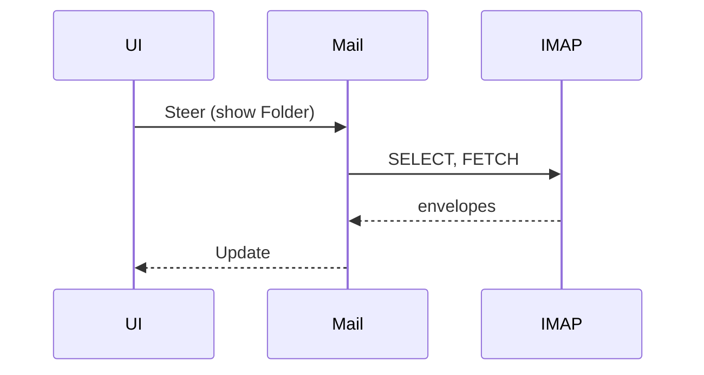

# PR

Every pull request body here follows
[.github/pull_request_template.md](../../../.github/pull_request_template.md).
Read it, fill each section as below, and delete its HTML comments. Keep the
`Before merging` checklist, ticking only what is true. Pass the body with
`gh pr create --body-file` so the Markdown survives the shell.

Skip preambles and keep prose brief. Use the words
[GLOSSARY.md](../../../GLOSSARY.md) and [ARCHITECTURE.md](../../../ARCHITECTURE.md)
use: Account, Folder, Thread, Message, Cache, Preview, Outbox, sync, layer.
Write in English, whatever language the request came in. Add no "Generated
with" line or other attribution, for the same reason
[AGENTS.md](../../../AGENTS.md) forbids a co-author trailer in a commit.

## Summary

Pick the smallest view that makes the key point clear, and put a line of why
beside it. Link the issue with `Closes #N`, or `Refs #N` when the issue stays
open after this pull request.

- Logic or an algorithm as pseudocode:

```text
on(idle wakes)
  if the shown Folder's UIDNEXT did not move
    keep the Cache as it is
  fetch the envelopes past the last cached UID
```

- Runtime control flow as a call tree:

```text
mail::serve::serve
  mail::sync::open
    mail::envelope_pass::step
    mail::flag_changes::send
  mail::idle::listen
```

- File responsibility or a broad refactor as a shallow file tree:

```text
src/
├── cache/   # the SQLite store of Messages, bodies and flags
├── mail/    # IMAP and SMTP: the sync, IDLE, the Outbox flush
└── ui/      # the TUI over what the Cache holds
```

- Component interaction or data flow with Mermaid:



- A `diff` when the point is what changes and the surrounding shape already
  exists. Match the diff shape to the topic:

```diff
 mail::sync::open
   mail::envelope_pass::step
-  mail::flag_changes::send
+  if the Cache holds queued flag changes
+    mail::flag_changes::send
+  mail::move_changes::send
```

- The whole block when most of it is new, when omitted context would hide
  ownership or order, or when the reader needs a copyable target shape.

Place each visual next to the short text it supports. Keep only the calls,
files, fields, states and boundaries needed to make the point. One view is
usually enough, several are sometimes needed, all of them never are.

## Evidence

Concrete evidence the change works: a before and an after.

- The TUI over `make demo` is S-tier when the change is visible there: a
  screenshot, or the screen described in text when one is not to hand.
- Execution-based evidence is A-tier: the exact test in `tests/` that failed
  and now passes, named, with its output; a `postal` CLI run and what it
  printed.
- `make check` green is the floor, not evidence. Say it only in the checklist.

## Merge Danger

**Door:** `one-way` or `two-way`. A two-way door is cheap to walk back. Here
the usual one-way doors are a Cache migration that a release has shipped, a
flag, Move or Delete written to the user's server, a `config.toml` key whose
meaning changes, a token or secret stored in the keychain, and an Outbox
Message that went out.

**Blast Radius:** one word, then a line of what could break and for whom: one
Provider (Gmail, iCloud), the Rendered View of some mails, the sync of every
Account, the Neovim plugin, the landing page, a frame's cost.
