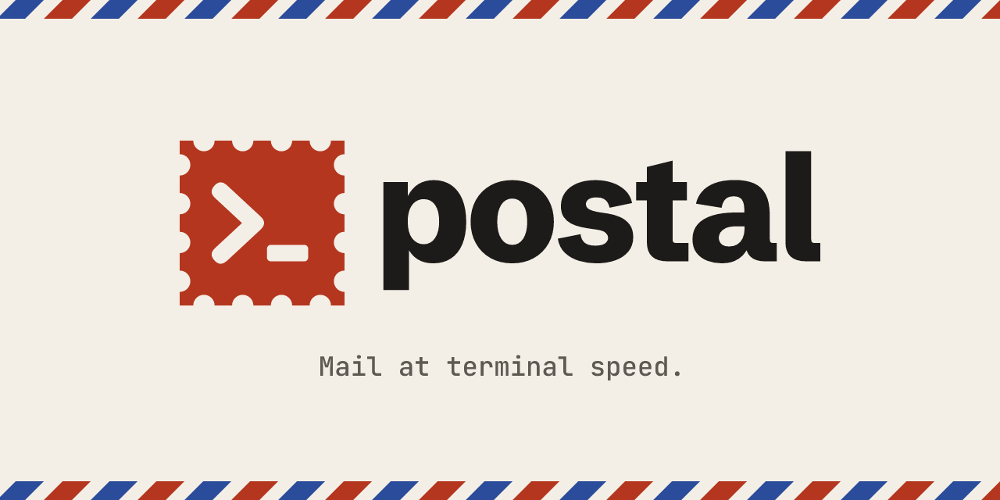

<div align="center">
  
  <p>A mail client for the terminal. Works with Gmail, iCloud and any IMAP server, shows HTML mail with its layout, and keeps everything on your computer.</p>
  <p>
    <a href="https://github.com/kryptamine/postal/releases"></a>
    <a href="https://www.rust-lang.org"></a>
    <a href="LICENSE"></a>
  </p>
  <p>
    <a href="https://postalmail.dev"><b>Website</b></a> ·
    <a href="nvim/"><b>Neovim plugin</b></a>
  </p>
</div>


## Install

On macOS 13+ or Linux with glibc 2.35+ (Ubuntu 22.04, Debian 12), arm64 or
x86_64:

```sh
curl -fsSL https://postalmail.dev/install.sh | sh
postal
```

The script puts `postal` in `~/.local/bin`. On first run Postal asks for a
mail provider and a sign-in; `?` lists every key. `postal update` replaces it
with the latest release. Each archive carries a build provenance
attestation; `gh attestation verify postal-<target>.tar.gz -R kryptamine/postal`
checks that the release workflow built it from this repository.

To build from source instead, with Rust 1.89+ and a C++ compiler:

```sh
git clone https://github.com/kryptamine/postal && cd postal
make install
```

`make install` puts `postal` in `~/.cargo/bin`, and over the `postal` found
first on `PATH` when that is another, as `install.sh`'s is.

## Neovim

Postal opens a Draft in `$EDITOR`. In Neovim 0.10+, the
[plugin](nvim/) completes `To:`, `Cc:` and `Attach:` as you type, and
`:PostalAgent` lets an [ACP](https://agentclientprotocol.com) agent edit the
Draft for you to review hunk by hunk. The plugin is optional, and calls
`postal`: keep it on the latest release with `postal update`.

### [lazy.nvim](https://github.com/folke/lazy.nvim)

```lua
{
  "kryptamine/postal",
  version = "*",
  main = "postal",
  opts = {},
}
```

### Without a plugin manager

```lua
vim.pack.add({
  {
    src = "https://github.com/kryptamine/postal",
    version = vim.version.range("*"),
  },
})
require("postal").setup({})
```

`vim.pack` needs Neovim 0.12; on older versions clone the repository at its
latest tag into a `pack/*/start/` directory on your `packpath`, then call
`require("postal").setup({})`.

[`nvim/`](nvim/) lists the options, commands and keys.

## Mail links

`postal setup-mailto` makes Postal the system's handler of `mailto:` links:
a click on one in a browser opens a terminal on a new Draft. On macOS it
installs a small launcher app in `~/Applications`, and Settings (`,`, the
Mailto tab) chooses Terminal.app, Ghostty, kitty, WezTerm, iTerm2 or a
program of your own; on Linux it writes a desktop entry, and the desktop
picks the terminal. `postal setup-mailto --remove`, or the same switch in
Settings, gives the links back to the handler before.

## Agents

`postal mcp` serves Postal's mail to any [MCP](https://modelcontextprotocol.io)
client on its stdio: Folders, Threads, Messages and Search, from what the
last sync left, and `folder_sync`, which fetches new mail when the TUI is
not open. In Claude Code:

```sh
claude mcp add postal -- postal mcp
```

The same tools are commands for a shell, `postal message list`, `postal
folder sync` and their siblings; `postal help` lists them, and `--json`
prints what the tools answer.

## Development

```sh
make        # list the targets
make check  # lint, cargo deny, tests and the Neovim check
```
