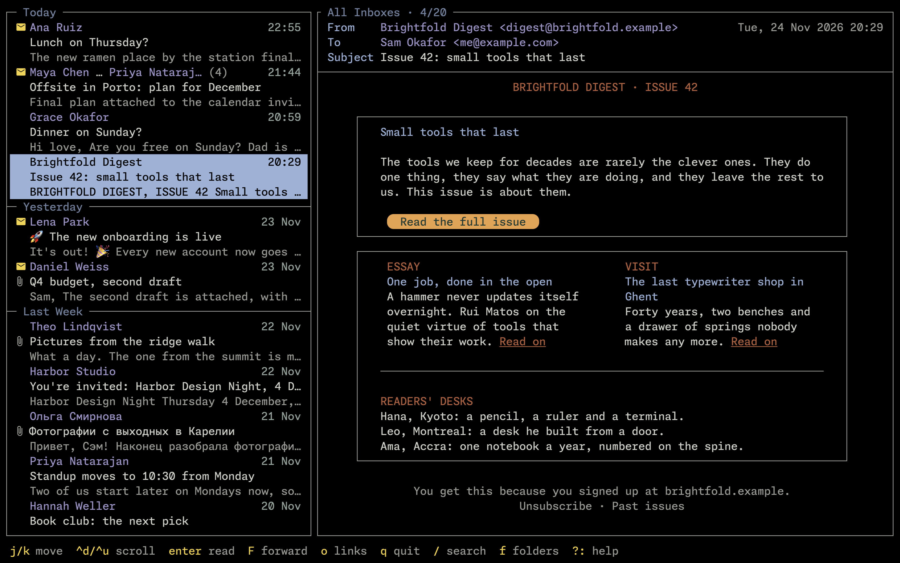

<div align="center">
  
  <p>A mail client for the terminal. Works with Gmail, iCloud and any IMAP server, shows HTML mail with its layout, and keeps everything on your computer.</p>
  <p>
    <a href="https://postalmail.dev"><b>Website</b></a> ·
    <a href="nvim/"><b>Neovim plugin</b></a>
  </p>
</div>



## Install

On macOS or Linux, arm64 or x86_64:

```sh
curl -fsSL https://postalmail.dev/install.sh | sh
postal
```

The script puts `postal` in `~/.local/bin` and the
[Neovim plugin](nvim/) in `~/.local/share/postal/nvim`. On first run Postal
asks for a mail provider and a sign-in; `?` lists every key.

To build from source instead, with Rust 1.89+ and a C++ compiler:

```sh
git clone https://github.com/kryptamine/postal && cd postal
make install
```

`make install` puts `postal` in `~/.cargo/bin` and the plugin in the same
place.

## Development

```sh
make        # list the targets
make check  # lint, cargo deny, tests and the Neovim check
```

## License

[MIT](LICENSE). Vendored code keeps its own: see
[THIRD_PARTY_LICENSES.md](THIRD_PARTY_LICENSES.md). Security issues:
[SECURITY.md](SECURITY.md).
